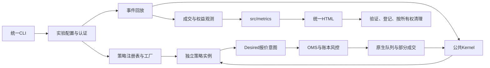

# 开发与架构

项目定位为本机Python做市研究与回测平台。对外入口见[README](../README.md)，执行规则见[AGENTS](../AGENTS.md)。

## 架构审计与本轮处理

本轮审计覆盖214个原有Python文件的定义及导入关系，结合CLI、配置、注册表、数据转换、订单状态机、策略、训练工具和测试核对实际调用链。原系统已经具备公共Kernel/OMS、原生撮合和统一HTML流程，主要障碍是边界仍靠人工维护：

- 策略及数学辅助与执行模块同放fusion；预热支持、NH模型和深度要求按策略名称散落判断，新增家族需要修改无关模块。
- 策略工厂的NH参数在复用同一工厂时共享可变对象；现有正式流程每账户创建工厂，未发现该问题造成历史结果变化。本轮统一每次构造深复制，并覆盖跨账户污染测试。
- 依赖检查只覆盖指定文件，新增文件、循环依赖和隐式包级加载缺少约束。预测包初始化时会反向加载构建器及其I/O依赖。
- prepare与原生回放各维护源码名单，公共指标和未来新增特征可能漏记。现统一登记app/src全部生产Python源码的哈希，不复制源码。
- 旧比较器读取已退役的分段摘要、runtime_image和SC1字段；report-existing仍依赖final_only已经清理的中间目录。旧原生记录指标适配只有自身测试使用，形成第二套指标口径；core.Store的SQLite持久化也只有旧模拟账户测试使用，当前接入已经使用live/journal。
- 三份队列辅助和一份开仓限制函数没有实际导入方、配置入口或独立参数资产；不因文件名带研究含义而永久保留。

资产处理：AS/NH/HJB及其数学、因果特征迁入strategies；删除旧比较器、原生记录指标适配、四份无调用辅助和report-existing路径；移除未使用的prediction包级转发导出和旧SQLite Store；保留账户政策状态的序列化测试，实际持久化只由当前live/journal维护。当前模型、原始/认证行情、既有最终HTML、因子数值合同及正式评测记录保留；独立行情浏览和已由正式结果覆盖的Notebook已清理。历史模型的来源哈希是当时记录，不改写成新路径以伪造原身份。删除前源码已建立Git检查点`ab1606c`，不保留工作目录备份。

## 目标结构与依赖方向

```text
app/__main__.py                      统一命令分发
app/backtesting/                     配置、认证、实验编排、观测、标准报告
app/market_making/strategies/         三类策略、数学/推理辅助、唯一注册表
app/market_making/contracts.py        报价意图与订单阶段数据类型
app/market_making/fusion/             Kernel、OMS、事件调度与原生撮合接线
app/market_making/live/               现有离线/在线接入原型
app/market_making/                    共享交易规则、账本和已验证AS政策/估计器
app/factor_library/                   公共因子定义与计算
app/prediction/                       因果预测样本与研究特征
app/market_data/                      公开行情采集与存储
src/metrics/                         唯一绩效计算口径
config/                              数据/执行/风险profile及策略/实验参数
```



图中Kernel调用注入对象，不导入具体策略。策略可以读取公共市场数据类型、交易规则和账户视图；不能导入或操纵OMS、原生撮合、网关、回测或报告。因子和预测不反向依赖策略。指标不依赖app。配置解析不启动worker，不生成报告。live复用Kernel，只有selection/runtime/replay接线能读取注册表。

`tools/maintenance/dependency_rules.py`通过AST遍历所有生产模块，含函数内导入，生成真实模块图并检测强连通分量；注册表的受控延迟加载也纳入图。新增文件自动受同一层规则约束，不能依赖更新文件白名单。测试中的临时策略不进入运行时。动态模块加载只允许受控注册表；通配符导入禁止。

## 策略开发合同

已有家族的新参数实验只改配置，参见[可运行示例](../config/experiments/as_s1_ablation.json)和[策略文档](strategies.md)。当前注册表只含AS/NH/HJB。确有不同数学或输入合同的新家族，新增一个策略实现、一个注册定义及参数profile；不得增加独立引擎或修改公共撮合来接入。

- 统一构造：`Strategy(rules, config, factors, params, symbol)`，每账户独立参数、观测器及可变状态。共同config为冻结数据。
- 必需生命周期：`book(ns,bid,ask)`、`reset_market()`和`desired(position,ns)`。报价返回`side -> Desired`，空字典表示撤销目标。继承`QuoteStrategy`复用因果观测。
- 深度策略显式实现`observe_market`、`observation_due`并声明`requires_quote_depth`；只消费脱离原生引擎的深度及成交副本。断线清理待处理输入。
- 可选`before_plan`接收在途订单/权益/mark，`on_fill`和`on_markout`只接收已经可见的反馈；`next_deadline_ns()`声明观察定时器，调度器不得窥探策略私有采样字段。
- 模块提供`validate_settings`和SOURCES；策略提供identity及必要诊断。按币模型另提供`validate_model_identity`。注册表集中声明版本、按币绑定、预热与深度能力，配置不能指定任意Python模块。
- 策略软库存政策可以更保守，不能放宽共同资金、挂单预占及风控。发单前OMS重新核对当前仓位与行情新鲜度，撤单未确认不释放额度。

接入测试`test_strategy_extension.py`临时登记一个真实固定价差策略，通过相同工厂、原生回放、BTC/ETH双费率、标准指标、HTML发布和工作区清理验证，并检查有实际模拟成交。该策略只存在于测试，正式注册表没有第四个家族。测试不是盈利或真实市场证据。

## 研究、报告和身份

实验的日期、币种、执行假设及费用共同配置；插件只管理数学参数。profile递归合并参数，拒绝未知字段和跨层覆盖。NH模型检查训练标签早于部署、维度/数值/币种和缓存身份；不能改哈希绕过认证。所有指标复用src/metrics；策略诊断与核心绩效分开。

`source_identity`统一登记app/src生产代码（含指标、特征和新增策略），排除测试、AppleDouble和符号链接。worker及报告生成前核验冻结输入与源码；中途修改运行代码须启动新run_id。每次实验保存展开配置、数据/模型身份、原生二进制SHA256和运行范围。最终仅保留验证过的单文件HTML与轻量登记，清理规则见[回测](backtesting.md)。

已有结果通过HTML中的标准payload读取。`backtest compare --html A --html B`只展示既有指标，不重算；数据、窗口、成本、账户、执行及公共指标源码必须一致。局部报告缺少可证明的完整共同覆盖，只能分别检查，不标记配对比较。

## 强制维护门禁

```sh
export PYTHONNOUSERSITE=1
export QUANT_DATA_ROOT=/外部行情根目录
python -B -m app check --native --tools
```

基础门禁包含目录产物、依赖方向、循环、动态加载、模块预算、因子目录、配置、指标、注册及清理测试。`--native`要求已验证的本机HFT环境，运行三类策略冻结轨迹、接入、因果时序、撮合、全部根层政策/账本回归和报告集成；`--tools`补充训练/数据/因子工具测试。缺依赖与跳过须单列，不能算行情认证通过。

新增模块默认450行上限；三个既有数值/状态实现按当前771/820/675行冻结，不能借重构继续膨胀。新增职责优先拆到真实所属层，不能通过转发文件规避。源码目录禁止生成产物、Markdown和备份包装。检查关闭pytest/Python磁盘缓存，Numba缓存使用临时目录。手动运行也使用`-B`，避免启动入口先生成字节码再触发目录门禁。

大规模变更先建立Git检查点；不保存源码副本。修改后的验证依赖风险范围，不以文件数或形式覆盖率代替行为证据。数学、时钟、成交假设和指标修正必须单独记录前后行为，不与架构迁移混在一起。

## 工具的职责与使用范围

`tools/data`是程序目录，根目录`data`是本机运行资产目录，不能因为名字相同而合并。正式做市回测始终通过app入口；辅助工具不是另一套做市系统，也不要求每次回测运行全部工具。

| 目录 | 保留职责 | 使用条件 |
|---|---|---|
| tools/data | 通用下载、覆盖检查、逐笔来源对照、自采验证、事件缓存准备及隔离区准备 | 显式输入日期、币种、数据根及输出；存在文件不等于通过回测认证 |
| tools/models | NH训练、通用预测样本、冻结15维基线样本和LightGBM研究训练 | NH按实验配置绑定；v3及基线是研究流程，不自动改变做市策略 |
| tools/factors | 因子目录、计算、阈值/量时钟冻结及预测增量评价 | 流速工具使用登记的固定研究协议，不能随意改日期后称确认性复现；原始输入缺失时须重新准备 |
| tools/experiments | 行情网格、成交触及、原生订单能力、PnL归因及HTML浏览器诊断 | 按明确问题调用；诊断JSON不是另一套金融报告；部分工具需要完整同口径报告或本机浏览器 |
| tools/ledger | 使用公共Ledger核对往返持仓和减仓收益分解 | 需要清理前的已验证工作明细，最终HTML发布并清理后不能凭空重建逐笔；source/output必须显式指定 |
| tools/maintenance | 开发门禁、全量依赖/目录检查、撮合时钟及资金费能力探针 | check为日常入口，探针只在引擎或时钟假设变更时调用 |
| tools/tests与maintenance/tests | 工具与架构检查的测试 | 随app check --tools运行，不是额外业务工具 |

单币WIF下载器已由通用`download_cryptohftdata.py`替代，旧multi转发名称不保留。容器账户归档、旧tasks/full-controls格式的历史日历工具和已无调用方的进程观察接口及其专用测试已删除；对应历史结果未删除。不会仅因一个遗留工具存在测试就保留它。

冻结15维样本组装和配对rankIC比较已取消PEPE固定文件名，使用显式输入、币种、测试边界与输出；配对bootstrap数值与清理前冻结样例一致。覆盖扫描与库存分析不再默认读取旧日期目录。HTML浏览器诊断适配当前双费率面板，并在BTC/ETH局部报告上实测筛选、44/22张可见图片及加载状态；这项验证不产生策略收益结论。

保留的专项工具不等于已完成所有真实数据窗口验收。工具清理通过基础门禁和完整工具测试；六项旧v3样本测试仍因缺少历史输入跳过。没有重新训练或启动行情下载，也没有重跑历史金融回测。

## 本机环境

Python 3.11；根requirements.txt固定直接依赖，paths.local.json仅配置本机解释器。当前使用quant_backtest及已验证的`hftbacktest 2.4.4+makerfix2`本机wheel，不能用PyPI普通版本替代。

```sh
python -m pip install -r requirements.txt
python -m pip install --no-deps /当前平台已验证的makerfix2.whl
```

Mac wheel位于`QUANT_DATA_ROOT/crypto/toolchain/backtest_build/reproducible-makerfix2-20261003/wheels`。wheel元数据声明NumPy>=2，但已验证数值组合为NumPy1.26.4；这是已知依赖声明不一致，不能声称pip依赖检查通过。新wheel需校验版本、二进制及回放。LightGBM固定4.6.0，训练使用callbacks早停；不能宣称与旧3.3.5模型数值相同。

项目不维护容器、生产部署镜像和独立策略执行器。live仍是接入原型，离线协议通过不表示交易所实盘验收，任何下单均需另行授权。

## 本轮验证与剩余边界

本轮迁移前后八组原生合成轨迹逐项一致，包括订单trace、成交、费用、库存、现金、PnL及权益数组哈希；未更新黄金数据。新策略接口测试另外验证模拟成交和完整标准报告，不修改核心引擎。2026-11-08最终运行`python -B -m app check --native --tools`：基础门禁143项、原生策略/接入/采集226项、回测及全部根层账户/政策292项、工具187项通过（不同组存在重复检查，不作为唯一测试总数）；另有18个子测试通过，6项旧样本测试跳过。目录、因子一致性、所有生产模块依赖及循环检查通过；根README、AGENTS和六份主题文档的本地Markdown链接均有效。

[最终CLI示例报告](reports/experiments/architecture-as-s1-example-20261108-v2/report.html)由实际外部BTC/ETH认证缓存运行，使用`config/experiments/as_s1_ablation.json`，两个AS参数组合×两币×双maker费率，共8组、66张嵌入图。命令限制`--max-segments 1 --max-files 1`，只读取首个上下文文件，尚未进入交易窗口，成交为0；这是认证输入到最终输出的局部验收，不是三日策略收益。报告登记为completed、full_range=false，96份运行源码身份与交付代码一致；发布登记成功后工作区删除，约9.8 MB中间文件释放。早一轮v1报告登记为superseded并保留，原有用户结果未覆盖。

完整13币历史收益不属于架构验收。NH仅BTC/ETH模型按当前缓存重训，其余11币仍须核验；六项旧v3样本测试可能因已清理的历史样本跳过。原始行情和模型没有因本轮重构被删除或改写。因子实现的独立数值哈希记录`doc/architecture/refactor/factor_migration.json`仍保留，属于数值身份合同。
